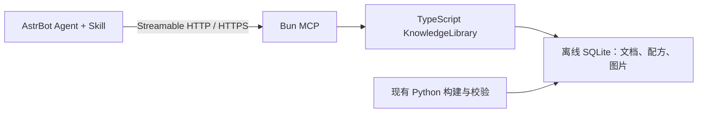

# TypeScript / Bun 离线 MCP

本轮提供一个独立 Bun MCP 服务，直接只读访问已发布格式的离线 SQLite 知识包。AstrBot 负责模型和对话；MCP 负责查询。查询不消耗 embedding token，也不调用官方在线站点。现阶段 `kb_search` 使用 FTS5 关键词检索，尚未连接 RAGFlow 的向量检索。



## 开发与运行

Linux 环境，Bun 1.4.4、Python 3、OpenSSL、flock。保留现有 Python 构建和 RAGFlow 管理命令。

```sh
bun install --frozen-lockfile
bun run typecheck
bun run test:ts
python3 -m unittest discover -s tests -v
bun run mode:mcp:start
bun run mode:mcp:health
bun scripts/check-mcp.ts
bun run mode:mcp:stop
```

必须先准备有效知识包。默认读取 `dist/offline/tfgm-library-r1`，参见 [离线包说明](offline-knowledge.md)。启动时检查 manifest 和数据库大小，读取资源时校验 SHA256；整库完整性校验仍使用现有 Python verify 命令。启动不会下载数据、自动安装依赖或替换运行中的知识包。

配置唯一存于 `.local/mode.json` 的 `mcp` 字段，由原有 `scripts/mode.py mcp-config` 在生命周期锁内初始化；现有字段保留。可调整 library、bindHost、portBase、logMaxBytes 和 logBackups，停止后修改并重启。端口由仓库身份派生，冲突时最多尝试后续 31 个端口。以 status 实际输出为准。

默认监听局域网，自签 HTTPS，证书包含 localhost、127.0.0.1 和当前 LAN IPv4。Bearer 令牌保存于 `.local/mcp/token`，不会写入日志或 Git。进程状态及证书位于 `.local/mcp`；停止前验证 PID、启动时间、进程组、cwd、命令及实例身份。管理器不修改原有 RAGFlow 容器。日志默认每份 10 MiB，保留 3 份备份。

`mode:mcp:status/help` 默认中文状态面板；`--json` 输出机器 JSON。健康失败返回非零。当前无系统开机自启配置。

## AstrBot 接入

按 [AstrBot 官方 MCP 文档](https://docs.astrbot.app/use/mcp.html)，在「插件 → MCP」新增服务器，使用 Streamable HTTP 配置。将运行状态里的可达局域网地址和本机令牌填入：

```json
{
  "transport": "streamable_http",
  "url": "https://YOUR_HOST:ACTUAL_PORT/mcp",
  "headers": {"Authorization": "Bearer YOUR_LOCAL_TOKEN"},
  "timeout": 30,
  "sse_read_timeout": 300
}
```

`.local/mcp/astrbot.example.json` 也提供占位示例。容器中的 127.0.0.1 指容器自身，应使用可达的宿主机地址。客户端需信任 `.local/mcp/certs/cert.pem`，通过 AstrBot 所在运行环境的 CA 信任配置安装；不要关闭 TLS 验证。证书重新生成时需更新信任。对外生产部署可在反向代理使用受信任证书。

测试连接应列出 8 个工具；保存后在人格能力中启用这些工具。将 [TFGM AstrBot Skill](../skills/tfgm-astrbot/SKILL.md) 按 AstrBot 的 Skill 导入流程安装。Skill 是查询规程，MCP 才提供实际能力。本轮已验证标准 SDK 客户端，尚未在真实 AstrBot 对话中验收。

## 工具和数据边界

| 工具 | 用途 |
| --- | --- |
| kb_status | 版本、覆盖数量、快照 |
| kb_search | 文档关键词检索 |
| kb_read_document | 分页原文和文档级媒体关联 |
| kb_search_items | 名称 / ID 候选 |
| kb_find_recipes | 制作配方索引 |
| kb_find_uses | 用途索引 |
| kb_get_recipe | 槽位、原始资源和图片路径 |
| kb_get_asset | 包内图片及分页 JSON / 文本 |

版本必填且不自动回退。当前包中 0.13.15 有 140426 条精确配方；0.13.17 主要是文档，不能借用旧版配方假充新版。每次返回携带 snapshot_id 和 source_mode。图片最多 2 MiB；长文本、配方槽位和索引均有限制及分页。槽位里的超长候选会摘要化，完整细节读取原始 JSON。工具不读取任意系统路径。

暂不提供完整路线规划、自动最优路线、在线查询工具或语义向量检索。后续把 RAGFlow 适配器接入同一知识服务，把在线工具放进显式 online_* 分组；离线工具继续保持不联网。新模块位于 apps/mcp-server、apps/cli、packages/contracts、packages/knowledge；不在本轮重写 Python 数据管道。

stdio 也可使用：设置 `TFGM_KNOWLEDGE_LIBRARY` 为包的绝对路径，执行 `bun run mcp:stdio`。客户端应直接启动 Bun 和 apps/mcp-server/src/stdio.ts，避免脚本包装器向协议 stdout 写日志。

独立容器部署与可选共享 RAGFlow 接入已补充，见 [容器部署说明](container-mcp.md)。容器默认仍提供 8 个离线工具；启用外部配置后增加 `kb_search_semantic`，不改变 `kb_search` 的离线行为。
